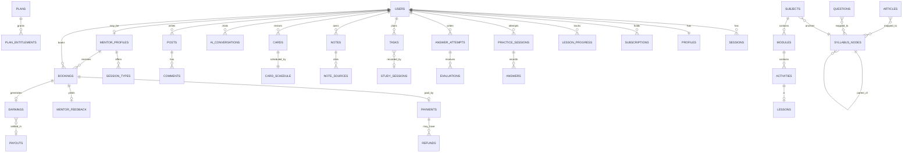

# 20 — Consolidated data model

**Status:** draft | **Last updated:** 2026-10-27
Single index of entities across modules. Column-level detail lives in each module spec (§6); this file defines ownership, cross-module references and global conventions so modules can be built independently. If a module spec and this file disagree, fix both.

## 1. Conventions
- IDs: UUIDv7 (time-ordered) `id uuid pk`; public references use short slugs where needed (subjects, communities, help articles).
- Timestamps: `timestamptz` UTC; user-facing times use user's `timezone` (IANA, default `Asia/Kolkata`). Money: integer **paise** (`*_minor`) + `currency 'INR'`.
- Soft delete: `deleted_at` on user-generated content (notes, posts, tasks); hard delete via retention jobs and DSR requests.
- Auditing columns: `created_at`, `updated_at`, `created_by`/`updated_by` where staff-managed.
- JSON: `jsonb` only for flexible blocks (rich content, config, snapshots); everything queried/filtered is a column.
- Multi-language readiness (D11): content tables that hold learner-visible text include `locale text default 'en'`; no per-language columns.
- Tenancy: single tenant. Row ownership by `user_id`; authorisation in services, plus Postgres RLS on high-risk tables (notes, answers, messages, ai_*, payments) `[PROPOSED]`.
- Schemas per module (`identity`, `billing`, `catalog`, `affairs`, `resources`, `practice`, `mains`, `planner`, `revision`, `progress`, `notes`, `askai`, `community`, `mentorship`, `payments`, `support`, `admin`, `search`, `notify`). **Cross-schema foreign keys are allowed only to `identity.users` and `catalog.syllabus_nodes`;** everything else is referenced by `(type, id)` and validated in the service layer.

## 2. Entity ownership map
| Module | Spec | Core entities |
|---|---|---|
| identity | 02 | users, auth_identities, auth_codes, sessions, profiles, preparation_profiles, study_preferences, consents, connected_accounts, data_export_jobs |
| billing | 03 | plans, plan_prices, feature_catalog, plan_entitlements, subscriptions, entitlement_overrides, usage_counters, invoices, coupons, coupon_redemptions, billing_events |
| notify/search | 04 | notifications, notification_preferences, quiet_hours, push_subscriptions, search_documents, search_queries |
| catalog | 05 | syllabus_nodes, subjects, modules, activities, lessons, content_sources, content_syllabus_map, lesson_progress, module_progress, subject_progress, media_assets |
| affairs | 06 | articles, article_analysis, user_article_state, story_clusters, digests, digest_items, ingest_log |
| resources | 07 | resources, resource_sections, resource_files, user_resource_state, legal_records, legal_timeline_events, legal_provisions, legal_amendments |
| practice | 08 | questions, question_versions, question_passages, question_assets, practice_sessions, session_questions, answers, bookmarks, mistake_entries, tests, test_results, question_stats, issue_reports, ai_generation_requests |
| mains | 09 | mains_questions, mains_question_keywords, model_answers, answer_attempts, answer_uploads, evaluations, rubrics, rewrite_queue, weakness_items, mentor_review_requests, paper_simulations |
| planner | 10 | tasks, recurrences, study_sessions, session_events, goals, plan_suggestions, calendar_links, exam_dates |
| revision | 11 | cards, card_schedule, review_logs, revision_sessions, session_cards, decks, revision_prefs |
| progress | 12 | daily_activity, topic_mastery, streaks, xp_events, xp_rules, achievements, user_achievements, weekly_snapshots, leaderboard_entries, metric_definitions |
| notes | 13 | notebooks, notes, note_sources, note_pages, note_versions, annotations, offline_items, export_jobs |
| askai | 14 | ai_conversations, ai_messages, ai_attachments, ai_preferences, ai_reports, ai_usage, ai_prompts, retrieval_chunks |
| community | 15 | communities, community_members, flairs, posts, comments, reactions, saved_items, follows, circles, circle_members, circle_events, peer_review_requests, peer_reviews, conversations, conversation_members, messages, blocks, messaging_prefs, reports, moderation_decisions, restrictions, appeals |
| mentorship | 16 | mentor_profiles, mentor_applications, mentor_credentials, session_types, availability_rules, availability_exceptions, slot_holds, bookings, booking_preparation, session_rooms, session_participants, session_messages, session_notes, session_materials, mentor_feedback, mentor_ratings, no_show_cases |
| payments | 17 | payments, refunds, ledger_accounts, ledger_entries, earnings, payouts, mentor_payout_accounts, disputes, fee_schedules, refund_policies, webhook_events |
| support | 19 | help_articles, help_categories, support_requests, support_messages, support_attachments |
| admin | 18 | staff_roles, audit_log, review_queue_items, feature_flags, announcements, import_jobs |

## 3. Core relationships (conceptual)

## 4. Polymorphic references (validated in services)
| Reference | Used by | Types |
|---|---|---|
| `source_ref (type,id,anchor)` | notes, cards, tasks, AI messages, planner, notifications | lesson, article, resource_section, legal_record, question, mains_attempt, note, booking |
| `target_ref` | notifications, reports, reactions, saved_items | any user-visible entity |
| `content_syllabus_map(entity_type, entity_id, node_id)` | catalog, affairs, resources, practice, mains, notes, cards | lesson, article, resource, legal_record, question, mains_question, card |
| `linked jsonb` | tasks | lesson, module, article, question set, note, mains question, booking |
Rule: deleting/unpublishing a referenced entity must leave a `status` or snapshot so dependants render a graceful "unavailable" state (designed in Figma: "Source unavailable", "Linked content unavailable").

## 5. Derived / analytical stores
- `progress.*` rollups are derived from events; rebuildable from raw event tables (`practice.answers`, `planner.study_sessions`, `catalog.lesson_progress`, `revision.review_logs`, `mains.evaluations`).
- `search.search_documents` and `askai.retrieval_chunks` are derived indexes (rebuildable); never source of truth.
- Analytics warehouse (later): export of anonymised events to a warehouse (BigQuery/ClickHouse) `[PROPOSED]`; not part of v1.

## 6. Data lifecycle and privacy
| Data | Retention | Notes |
|---|---|---|
| Notes, answers, attempts, cards | until user deletes or account deletion (+30 days grace) | Trash 30 days for notes |
| AI conversations | until user deletes; temporary chats not stored | exclude from training; DSR export includes |
| Mentor chat/notes | 90 days after session unless dispute | |
| Payments/ledger/invoices | 8 years `[PROPOSED; confirm with CA]` | anonymise personal fields on deletion where law permits |
| Audit logs | 3 years | append-only |
| Logs/analytics | 13 months | PII-minimised |
| Support requests | 2 years after closed | |
Account deletion: soft-delete (`deleted_pending`) → 30-day grace → purge job removes user-owned content, anonymises community content (`deleted user`), keeps financial records as required.

## 7. Migration and seeding
- Forward-only SQL migrations per module; shared seed: syllabus tree (from official syllabus), feature catalogue, default `free` plan (generous until O1), exam dates, rubrics, XP rules, communities, achievement definitions.
- Content seeding scripts for development only; real content arrives via admin imports.
